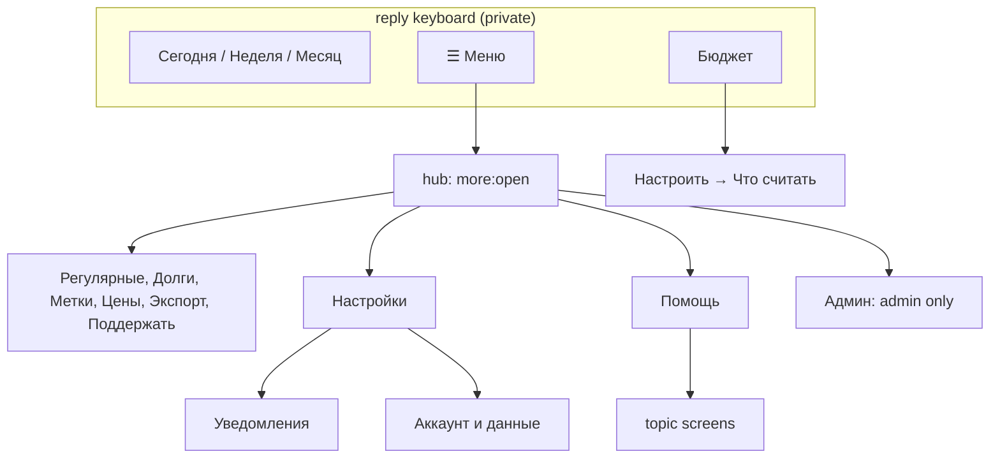

# 0049: A ☰ Меню hub edited in place, a six-button bar, and deeper settings, budget and help

> **Status:** in-progress
> **Created:** 2026-10-11
> **Related ADRs:** [ADR-0050](../adrs/0050-a-second-navigation-level-menu-hub-edited-in-place.md),
> ADR-0011, ADR-0040, ADR-0017, ADR-0028

## TL;DR

The private chat gets a second navigation level (ADR-0050). The bar shrinks from eight buttons
in two rows of four to two rows of three: `[📊 Сегодня] [📅 Неделя] [🗓 Месяц]` /
`[💰 Бюджет] [📷 Скан] [☰ Меню]`. [☰ Меню] opens a hub that is edited in place. Each screen it
opens has [« Назад] back to it, and the admin's buttons move to their own sub-screen. /settings
splits into Уведомления and Аккаунт и данные, /budget leads with the figures and puts its setup
behind [Настроить], and /help becomes a short screen with topic buttons. The expense card loses
its [Повторять] row, which moves into [Изменить]. The first thing the user sees: after /start,
the bar has six buttons, and [☰ Меню] → [Долги] → [« Назад] stays in one message.

## Context & problem

A ux-telegram review (2026-10-11, delivered in the conversation) found nothing broken but
structural clutter. ADR-0050 records the measurements. In the code:

- `menuKeyboard` (`src/bot/keyboards.ts`) puts four buttons on each row.
- `sendMore` and `runTap` (`src/bot/handlers/more.ts`) send «Ещё» and each screen it opens as new
  messages, and none of them leads back.
- `settingsView` (`src/bot/handlers/settings.ts`) draws eight rows.
- The /budget `screenView` (`src/bot/handlers/budget.ts`) shows five setup rows on the screen
  users open to read what's left. Its [Только необязательные] depends on a flag set elsewhere,
  in /categories → [Обязательные] (`cat:ess`).
- `messages.help` is 35 lines, 3,411 of 4,096 characters.
- On a receipt card whose fetch failed, `recordedCard` (`src/bot/handlers/card.ts`) stacks
  [Повторять] (repeat the expense) above [Повторить] (retry the receipt).

Plan 0048 (approved, queued in conductor lane b) reorders «Ещё» in its Phase 1 and adds [Траты]
under /today in its Phase 2. **This plan runs after 0048** and replaces 0048 Phase 1's layout.
That is a deliberate, accepted bit of throwaway (the user's choice, 2026-10-11).

## Decision

The hub is the existing `more:` screen, rebuilt. A tap edits the tapped message and adopts it as
the anchor, as `showSettingsInPlace` already does for the setup check. [« Назад] is `more:open`,
which redraws the hub in place and cancels any pending flow. A screen remembers that it came
from the hub so that its pagers, sub-screens and flow prompts return to a screen that still
carries [« Назад]. A stateful screen keeps this as a `fromMenu` flag in its anchor screen,
mirroring `fromSettings`. A stateless one (tags, export, donate, privacy, changelog) keeps it as
a marker in its callback data. Typed commands are unchanged. /help becomes a screen, and the bar
rides only on /start. We rejected reordering the flat «Ещё» (ADR-0050 Alternative A), keeping
/help as a text that carries the bar (Alternative B), and trimming the "/" list (Alternative C,
the user kept Plan 0034's full list).

## Architecture diagram



## Implementation phases

### Phase 1: The six-button bar and the ☰ Меню hub, edited in place

- **Owner skill:** dev
- **What:**
  - **The bar.** `menuKeyboard` draws `[📊 Сегодня] [📅 Неделя] [🗓 Месяц]` /
    `[💰 Бюджет] [📷 Скан] [☰ Меню]` (no [📷 Скан] without `webappUrl`). `messages.menu` drops
    `settings` and `help` and renames `more` to `'☰ Меню'`. `ROUTES` keeps the old labels as
    aliases: `'⚙️ Настройки'` → `sendSettings`, `'❓ Помощь'` → help, `'☰ Ещё'` → the hub.
  - **The hub.** Text `messages.moreScreen` = `<b>Меню</b>`. Rows, from the top:
    - [Поддержать], alone
    - [Регулярные] [Долги]
    - [Метки] [Цены]
    - [Экспорт] [Настройки]
    - [Помощь], alone
    - the lock/unlock toggle, alone, for a sealed ledger only
    - [Админ], alone, for the admin only

    The [Настройки] (`more:set`) and [Помощь] (`more:help`) buttons are new.
  - **In place.** A hub tap answers the callback, cancels the pending flow (as `runTap` does
    now), and edits the tapped message into the screen the typed command would send, with
    [« Назад] (`more:open`) alone on its bottom row. A stateful screen (recurring, debts, prices,
    settings) adopts the tapped message as the anchor with `fromMenu: true`. Its sub-screens and
    flow prompts keep their current back routes, and its top level keeps [« Назад] → hub after a
    pager tap, a cancel or a completed flow. A stateless screen (tags, export, donate, privacy,
    changelog) carries the hub marker in its own callback data, so its pager and steps keep the
    [« Назад] → hub.
  - **Moved out of the hub.**
    - [Включить метку] becomes part of /tags. The list's text gains
      `Постоянная метка: #<name>` or `Постоянной метки нет`, and the keyboard gains
      [Постоянная метка] (`tag:sticky`), which starts the existing `commandArg` `tag` flow. While a
      sticky tag is on, it shows [Снять метку] instead, the existing `stickyTagOffButton` action.
    - [Возврат пожертвования] becomes [Вопрос о пожертвовании], the last row of the /donate
      screen (`more:pay`).
    - [Приватность] and [Удалить аккаунт] move to Phase 2's Аккаунт и данные. Until Phase 2
      lands they stay in the hub, as one pair above [Помощь].
  - **Admin.** [Админ] (`more:adm`) edits the hub into the six admin buttons, two per row, then
    [« Назад] → hub. From anyone else, `more:adm` falls through to the silent unknown answer,
    as `adm:*` does now.
  - **Copy.** `welcome`'s third line becomes «Итоги открываются кнопками меню внизу, всё
    остальное — в «☰ Меню». Подробности: /help.» The `more` scenario and
    `site/src/content/docs/guide/start.mdx` show the new bar and hub.
- **Files touched:** `src/bot/keyboards.ts`, `src/bot/handlers/menu.ts`,
  `src/bot/handlers/more.ts`, `src/bot/handlers/tags.ts`, `src/bot/handlers/donate.ts`,
  `src/bot/handlers/recurring.ts`, `src/bot/handlers/debts.ts`, `src/bot/handlers/prices.ts`,
  `src/bot/handlers/export.ts`, `src/bot/handlers/privacy.ts`, `src/bot/handlers/changelog.ts`,
  `src/bot/handlers/settings.ts`, `src/bot/callbackData.ts`, `src/services/flowSessions.ts`,
  `src/bot/flows.ts`, `src/bot/messages.ts`, `src/bot/bot.test.ts`,
  `scripts/docs-chats/scenarios/more.ts`, `scripts/docs-chats/scenarios/tags.ts`,
  `site/src/content/docs/guide/start.mdx`, `site/src/content/docs/guide/tags.mdx`.
- **Done when:**
  - /start's reply keyboard is exactly two rows of three labels with `webappUrl`, and
    `[💰 Бюджет] [☰ Меню]` as its second row without it.
  - Sending the text `⚙️ Настройки`, `❓ Помощь` or `☰ Ещё` answers as /settings, /help and
    [☰ Меню] do. None of those labels, nor `☰ Меню`, records an expense (the existing label test
    covers the aliases).
  - [☰ Меню] → [Долги] edits the hub message (an `editMessageText` on the hub's `message_id`,
    no `sendMessage`) into `messages.debtsScreen`'s text, with [« Назад] as the last row.
    [« Назад] edits the same message back into `<b>Меню</b>`.
  - [☰ Меню] → [Метки] on a ledger with 10 tags shows page 1. [▶] then shows page 2 with
    [« Назад] still the last row. A typed /tags shows page 1 with no [« Назад].
  - [☰ Меню] → [Долги] → [Я дал в долг] → [Отмена] returns to the debts list, still with
    [« Назад] → hub.
  - The Plan 0034 test "answers %s exactly as /%s does" becomes: for each direct hub button,
    the tap's edited text equals the typed command's sent text, and exactly one
    `answerCallbackQuery` is made.
  - The reachability test ("finds the private and admin commands, and none without a button")
    still passes. Coverage is computed from the bar, the hub and every sub-screen button, so
    `tag`, `paysupport`, `settings`, `help`, `block` and `refund` are each covered.
  - A non-admin's tap on `more:adm` changes nothing and is answered silently.

### Phase 2: /settings split into Уведомления and Аккаунт и данные

- **Owner skill:** dev
- **What:**
  - **The personal hub.** `settingsView` draws [Часовой пояс] [Валюта] /
    [Категории] [Уведомления] / [Аккаунт и данные], and [« Назад] → hub when `fromMenu`.
    `settingsScreen` gains the line
    `Итоги: месяц — ${'вкл'|'выкл'}, неделя — ${'вкл'|'выкл'}`. The scoped (group) hub is
    unchanged.
  - **Уведомления** (`set:ntf`). Text `notificationsScreen`: «<b>Уведомления</b>\nИтоги месяца
    приходят утром после конца месяца, итоги недели — по понедельникам. Подсказки — не чаще раза
    в день.\n«Убирать мои сообщения» — удалять ваше сообщение, когда трата из него записана.»
    Below it come the four existing switches, one per row, then [« Назад] → settings. A switch
    re-renders this screen, not the settings hub.
  - **Аккаунт и данные** (`set:acc`). Text `accountScreen`: «<b>Аккаунт и данные</b>\nШифрование:
    выключено.», or «…включено, учёт открыт.» / «…включено, учёт закрыт.». Buttons:
    [Шифрование] [Приватность] / [Удалить аккаунт] / [« Назад] → settings. The encryption
    screens' and prompts' [« Назад] and cancel return here instead of to the settings hub.
    [Приватность] (`set:prv`) and [Удалить аккаунт] (`set:del`) edit the anchor into
    `messages.privacy` and the delete prompt. The prompt keeps its two buttons, and [« Назад]
    and «Ничего не удалено» return here.
  - **The hub.** [Приватность] and [Удалить аккаунт] leave it.
  - **Copy that names a path:**
    - `tipEncrypt` → «…Включается в настройках: «Аккаунт и данные» → «Шифрование».»
    - `unlockNotSealed` → «…Включить шифрование: /settings → «Аккаунт и данные» → «Шифрование».»
    - `tipsOff` → «Подсказки отключены. Включить: /settings → «Уведомления».»
    - `pushOff` → «… Включить: /settings → «Уведомления».»
    - `tipEncrypt` is offered on the Аккаунт и данные screen instead of on the settings hub.
- **Files touched:** `src/bot/handlers/settings.ts`, `src/bot/handlers/unlock.ts`,
  `src/bot/handlers/deleteAccount.ts`, `src/bot/handlers/privacy.ts`, `src/bot/handlers/more.ts`,
  `src/bot/tips.ts`, `src/bot/callbackData.ts`, `src/services/flowSessions.ts`,
  `src/bot/flows.ts`, `src/bot/messages.ts`, `src/bot/bot.test.ts`,
  `scripts/docs-chats/scenarios/settings.ts`, `scripts/docs-chats/scenarios/encryption.ts`,
  `scripts/docs-chats/scenarios/privacy.ts`, `site/src/content/docs/guide/start.mdx`,
  `site/src/content/docs/guide/encryption.mdx`, `site/src/content/docs/guide/data.mdx`.
- **Done when:**
  - /settings for a user with monthly on and weekly off shows «Итоги: месяц — вкл, неделя —
    выкл» and exactly three rows of buttons, with no [« Назад] (typed command).
  - [Уведомления] → [Итоги недели: выкл] turns weekly on, and the same message then shows
    [Итоги недели: вкл] on the Уведомления screen.
  - [Аккаунт и данные] → [Удалить аккаунт] → [Удалить всё] deletes the account as /delete_account
    does. On a second account, [Аккаунт и данные] → [Удалить аккаунт] → [« Назад] shows
    Аккаунт и данные and deletes nothing.
  - The encryption enable prompt's [Отмена] returns to Аккаунт и данные with «Шифрование:
    выключено.»
  - The group-scoped settings hub (`/start gs_<uuid>`) still shows [Часовой пояс] [Валюта] /
    [Бюджет] (its existing test passes unchanged).

### Phase 3: /budget leads with the figures; its setup sits behind [Настроить]

- **Owner skill:** dev
- **What:**
  - **The read view.** With a limit, /budget keeps `budgetScreen`'s text and has [📈 Диаграмма]
    (when the chart URL exists) and [Настроить] (`bud:cfg`), then [« Назад] when opened from the
    settings hub or the menu. With no limit and no caps, it has only [Задать лимит] (the
    existing `bud:lim` flow). Once the limit is saved, the anchor shows the read view.
  - **Настроить.** Text `budgetSetupScreen`: «<b>Настройка бюджета «${ledger}»</b>\nЛимит:
    ${money} на период\nПериод начинается ${day}-го числа\nСчитаются ${'все траты' | 'траты без
    обязательных'}». A missing limit reads «Лимит: не задан». Buttons, one per row:
    - [Лимит на период] (`bud:lim`)
    - [День начала периода] (`bud:day`)
    - [Что считать] (`bud:what`)
    - [Лимиты по категориям] (`bud:caps`)
    - [« Назад] → the read view

    Prompts and the caps list return to Настроить instead of to the screen top.
  - **Что считать.** Text `budgetScopeScreen`: «Бюджет может считать все траты или только
    необязательные. Обязательные — то, без чего не обойтись: жильё, продукты, связь.» Buttons:
    - [Все траты] [Без обязательных], with the current one marked `✓ `
    - [Обязательные категории] (the existing essential picker, with its back now → Что считать)
    - [« Назад] → Настроить

    `budgetScopeButton` labels become `'Все траты'` / `'Без обязательных'`.
  - **/categories** loses [Обязательные]. `cat:ess*` callbacks are handled on the budget
    screen's anchor instead. A `cat:ess` tap on a categories anchor gets `staleScreen`.
- **Files touched:** `src/bot/handlers/budget.ts`, `src/bot/handlers/categories.ts`,
  `src/bot/handlers/settings.ts`, `src/bot/callbackData.ts`, `src/services/flowSessions.ts`,
  `src/bot/flows.ts`, `src/bot/messages.ts`, `src/bot/bot.test.ts`,
  `scripts/docs-chats/scenarios/budget.ts`, `scripts/docs-chats/scenarios/budget-set.ts`,
  `scripts/docs-chats/scenarios/categories.ts`, `site/src/content/docs/guide/budget.mdx`.
- **Done when:**
  - With no budget, /budget's keyboard is exactly one button, `bud:lim`. Answering `30 000`
    stores `limit_minor` 3000000 in RSD and edits the anchor into the read view with
    [Настроить].
  - With that limit, /budget's keyboard has no `bud:day`, `bud:scope:*` or `bud:caps` button.
    [Настроить] shows all four setup buttons and «Лимит: 30 000.00 RSD на период».
  - [Настроить] → [Что считать] → [Без обязательных] sets scope `optional`, toasts
    `budgetScopeChangedToast` and re-renders with «✓ Без обязательных».
  - [Что считать] → [Обязательные категории] → a category marks it essential (the Plan 0003-era
    essential tests pass, moved to the budget anchor). [« Назад] returns to Что считать.
  - /categories shows [Добавить] / [Переименовать] [Скрыть] and no [Обязательные].
  - A group's /budget reply (read-only) is unchanged.

### Phase 4: /help becomes a short screen with topics; the bar rides on /start only

- **Owner skill:** dev
- **What:**
  - **The help screen.** /help, [Помощь] in the hub and the `❓ Помощь` alias show `helpCore`:
    «<b>Помощь</b>\nОтправьте сумму и описание: «450 кофе». Валюта — после суммы: «12,50 EUR
    такси», «300 € ремонт»; тысячи — буквой к: «45к шкаф». Задним числом: «450 такси
    вчера».\nПод записанной тратой: [Категория], [Изменить] и [Удалить].\nПодробнее — по темам:»,
    plus Plan 0048's multi-line line if it has shipped.
    - Buttons:
      - [Как записать] [Чеки и выписки]
      - [Итоги и бюджет] [Долги и метки]
      - [Регулярные] [Группы]
      - [Руководство] (URL `DOCS_URL`)
      - [Что нового] (`more:chg`, in place)
      - [« Назад] → hub, only when opened from the hub
    - Callback `help:<topic>` with a hub marker, at most `help:recurring:m` = 16 bytes.
    - From /help it is a new message and carries no reply keyboard. `sendStrayReply`'s first full
      help sends this screen.
  - **Topics.** `helpTopics.{record, receipts, totals, debts, recurring, groups}` hold the current
    `messages.help` paragraphs regrouped:
    - **record:** recording, past dates, the card buttons, /cancel, and Plan 0048's multi-line
      and [Траты] lines.
    - **receipts:** receipts, bank SMS, the statement.
    - **totals:** FX, the summary push, today/week/month/budget, /export.
    - **debts:** debts and tags.
    - **recurring:** recurring.
    - **groups:** the group paragraph, the history import, /settle.

    Each topic ends with [« Назад] → the help screen, keeping the hub marker. The menu-legend
    lines («📊 Сегодня — …») are dropped. `helpDocsLine` and `helpDonateLine` become the
    [Руководство] button and the hub's [Поддержать].
  - **The bar.** `sendHelp` no longer attaches `menuKeyboardFor`. Only `sendWelcome` (/start)
    does.
- **Files touched:** `src/bot/handlers/help.ts`, `src/bot/handlers/more.ts`,
  `src/bot/handlers/menu.ts`, `src/bot/handlers/other.ts`, `src/bot/handlers/text.ts`,
  `src/bot/callbackData.ts`, `src/bot/messages.ts`, `src/bot/messages.test.ts`,
  `src/bot/bot.test.ts`, `scripts/docs-chats/scenarios/start.ts`,
  `site/src/content/docs/guide/start.mdx`.
- **Done when:**
  - /help sends one message whose `reply_markup` is an inline keyboard holding the six topic
    buttons, a `url` button to `DOCS_URL` and [Что нового]. Its visible text is under 1,000
    characters.
  - [Чеки и выписки] edits the same message into a text containing «Korišćenje kartice» and
    «Izvod po tekućem računu». [« Назад] edits it back into `helpCore`.
  - The six topic bodies together contain each of «вчера», «/3», «#отпуск», «result.json»,
    «/settle» and «09:00». Each topic's visible text is at most 4,096 characters
    (`messages.test.ts`).
  - /start still sends the welcome with the reply keyboard. /help's reply has no
    `keyboard` field.
  - A first stray message from an onboarded user gets the help screen, and the second gets
    `notUnderstood` (ADR-0037 test, updated for the new screen).

### Phase 5: The card loses [Повторять]; small label fixes

- **Owner skill:** dev
- **What:**
  - **The card.** `recordedCard` no longer draws [Повторять]. The [Изменить] picker becomes
    [Сумма] [Описание] [Дата] [Метки] / [Повторять] (author only, the existing
    `repeatExpenseData`) / [« Назад]. The schedule picker's back still goes to the card.
  - **Copy for [Повторять].**
    - The help «recurring» topic says «…на карточке траты нажмите [Изменить] → [Повторять]…».
    - `recurringList`'s empty line says «…нажмите под ней «Изменить» → «Повторять».»
  - **Labels.**
    - `receiptRetryButton` → `'Загрузить позиции'`.
    - `periodItemsButton` → `'Позиции чеков'`.
    - `exportBackButton` is deleted, and the export picker uses `backButton` («« Назад»).
  - **Locked replies.** `ledgerLocked`, when sent as a reply (/today, /week, /month, /budget),
    carries [Открыть учёт] (`more:unl`, the existing unlock entry).
- **Files touched:** `src/bot/handlers/card.ts`, `src/bot/handlers/edit.ts`,
  `src/bot/handlers/export.ts`, `src/bot/handlers/today.ts`, `src/bot/handlers/summary.ts`,
  `src/bot/handlers/budget.ts`, `src/bot/messages.ts`, `src/bot/bot.test.ts`,
  `scripts/docs-chats/scenarios/recurring.ts`, `scripts/docs-chats/scenarios/record.ts`,
  `site/src/content/docs/guide/recurring.mdx`, `site/src/content/docs/guide/record.mdx`.
- **Done when:**
  - The author's card for a typed `450 кофе` has two rows: [Категория] [Изменить] / [Удалить].
  - A receipt card whose fetch failed has [Категория] [Изменить] / [Загрузить позиции] /
    [Удалить], with no label starting «Повтор».
  - [Изменить] on the author's card shows [Повторять] on row 2. Tapping it shows the schedule
    picker, and choosing «Каждый месяц» creates the rule exactly as the card button did (the
    Plan 0025 rule tests pass via the new path). A non-author viewing a shared card's [Изменить]
    gets no [Повторять].
  - No message in `messages.ts` or keyboard uses the text `← Назад`.
  - /today on a locked sealed ledger answers `ledgerLocked` with one button, data `more:unl`.

### Phase 6: Live check

- **Owner skill:** human
- **Blocks merge:** no
- **What:** On a phone about 360 px wide, send /start and check that no bar label is truncated.
  Walk [☰ Меню] → [Метки] → [▶] → [« Назад], then [Настройки] → [Уведомления]. Open /budget
  with and without a limit, and open /help → a topic → [« Назад].
- **Files touched:** none.
- **Done when:** Every path stays in one message and every label reads in full.

## Data shapes

```ts
// illustrative: src/services/flowSessions.ts
// Each stateful screen reached from the hub gains `fromMenu?: true`, mirroring
// `fromSettings`. SettingsScreen gains a `pane` for its sub-screens; BudgetScreen gains one for
// its setup.
interface SettingsScreen { name: 'settings'; ledgerId?: LedgerId; fromMenu?: true;
  pane?: 'notifications' | 'account' }
interface BudgetScreen { name: 'budget'; ledgerId: LedgerId; fromSettings?: true;
  fromMenu?: true; pane?: 'setup' | 'scope' | 'essential' }
```

New callback data, all well under 64 bytes:

| Data | Bytes |
|---|---|
| `more:open` | 9 |
| `more:set` | 8 |
| `more:help` | 9 |
| `more:adm` | 8 |
| `set:ntf` | 7 |
| `set:acc` | 7 |
| `set:prv` | 7 |
| `set:del` | 7 |
| `bud:cfg` | 7 |
| `bud:what` | 8 |
| `tag:sticky` | 10 |
| `help:recurring:m` (longest topic with the hub marker) | 16 |

A stateless screen's hub marker adds at most 2 bytes to its existing data. `more:pay`, `more:unl`
and `more:chg` are reused.

## Risks & open questions

- **Old bars.** Clients keep the eight-button bar until their next /start. The aliases keep every
  old label working, and the label-is-not-an-expense test must cover them. ADR-0013 announces
  versions only to the admin, so nothing prompts users to /start. That's accepted (ADR-0050).
- **Flows started from a hub screen.** A text flow (a debt amount, a reminder text, a budget
  limit) must, on completion, cancel or expiry, re-render a screen that still has its [« Назад]
  → hub. The done-whens test the debts cancel path. The other prompts follow the same
  `fromMenu` read.
- **Idempotency.** No new writes. The toggles and the scope are set-to-value, as today, so a
  double tap re-renders the same state.
- **Telegram.** Half-row labels stay at most 14 characters («Итоги и бюджет», «Позиции чеков»).
  Longer labels («Обязательные категории», «Вопрос о пожертвовании», «Аккаунт и данные») get a
  full row.
- **Plan 0048 overlap.** This plan rewrites 0048 Phase 1's hub layout and extends 0048 Phase 2's
  [Траты] row with the `Позиции чеков` label. It must start after 0048 closes.

## What this plan does NOT do

- Trim the "/" command list. Plan 0034's full list stays (ADR-0050 Alternative C).
- Change the group chat: its commands, `groupHelp` and the group /budget reply are untouched.
- Send the new bar to existing users unprompted.
- A topic screen per feature beyond the six. The [Руководство] link carries the long form.
- Move [Категории] out of /settings.

## Implementation log

> Written by `dev`: one row per phase as its commit lands, then the close block. **The phases
> above are the contract. This section records what happened.** Observations, never conclusions:
> no pass list, no self-assessment. Deviations and unmet done-whens are **always** disclosed.
> Keep it shorter than `## Implementation phases`.

| phase | owner | state | commit |
|---|---|---|---|
| 1: Bar and ☰ Меню hub | dev | done | adb66c4 |
| 2: Settings split | dev | done | 4dbb764 |
| 3: Budget read-first | dev | done | committed with this row |
| 4: Help topics | dev | not started | |
| 5: Card and labels | dev | not started | |
| 6: Live check | human | not started | |

### Notes

- Phase 1: [Что нового] (`more:chg`, in place) sits under the hub's [Помощь], which edits the
  hub into `messages.help` with [Что нового] and [« Назад]. The plan's Phase 1 hub has no
  changelog button, and the reachability guard needs one.
- Phase 1: [Удалить аккаунт], [Открыть учёт] / [Закрыть учёт], [Вопрос о пожертвовании],
  [Постоянная метка] and the admin's six buttons still send a new message, as their typed command
  does. The in-place test covers `MENU_IN_PLACE` (donate, recurring, debts, tags, prices, export,
  settings, privacy, help, changelog); the rest keep the "answers exactly as /x" test.
- Phase 1: the admin sub-screen's text is a new `messages.adminScreen` («<b>Админ</b>»); the plan
  names none.
- Phase 1: with `menu.settings` and `menu.help` gone, `notUnderstood` reads «…— в /help.» and the
  help text's legend lines name /settings and /help.
- Phase 1: `CategoriesScreen` also carries `fromMenu`, so settings → [Категории] → [« Назад]
  keeps the settings hub's [« Назад] to the menu.
- Phase 1: /tags with no tags shows `tagsEmpty`, the sticky line and [Постоянная метка];
  `donateUnavailable` also carries [Вопрос о пожертвовании]. [Снять метку] on /tags is the
  existing `tag:off` action, which edits the screen into `stickyTagOff`.
- Phase 1: a debt recorded from a hub-opened debts screen keeps [« Назад] → hub under its
  confirmation.
- Phase 1: `withMenuBack` and `MenuOpened` live in `src/bot/keyboards.ts`; `src/bot/screens.ts`
  is not in the phase's files.
- Phase 1: the commit adb66c4's body is not plain ASCII (button labels in it).
- Phase 2: `src/bot/handlers/unlock.test.ts` (outside the phase's files) changes one expectation:
  the encryption screen's [« Назад] is `set:acc`.
- Phase 2: [Отмена] on the delete prompt in Аккаунт и данные re-renders that screen with
  «Ничего не удалено.» above it; the handler sits in `settings.ts` ahead of the command's own.
- Phase 2: the hub no longer draws or answers `more:prv` / `more:del`; an old hub copy's tap on
  them gets the silent unknown answer. The reachability guard counts `set:prv` and `set:del`.
- Phase 2: the `settings` and `privacy` scenarios keep their final screen (the hub; the policy),
  `privacy` and `encryption` now reach it through Аккаунт и данные.
- Phase 3: `BudgetScreen` gains `pane` but not `fromMenu`: no hub button opens /budget (it is on
  the bar), so nothing would set it.
- Phase 3: the read view counts "a cap is set" from the status's caps; a budget row holding only a
  start day or a scope reads as unset and shows only [Задать лимит]. A limit saved from the read
  view's [Задать лимит] returns to the read view; one saved from Настроить returns to Настроить.
- Phase 3: `src/bot/handlers/settings.ts` and `scripts/docs-chats/scenarios/categories.ts` needed
  no change. The `budget-set` scenario now ends on Настроить.
- Phase 3: `site/src/content/docs/guide/record.mdx` still says /categories has «Обязательные»; it
  is outside this phase's files (Phase 5 lists it).

### Close triggers

- **What shipped:**
- **User-visible surface changed:**
- **Gate at the tip:**
- **Outstanding `human` phases:**

## Followups
