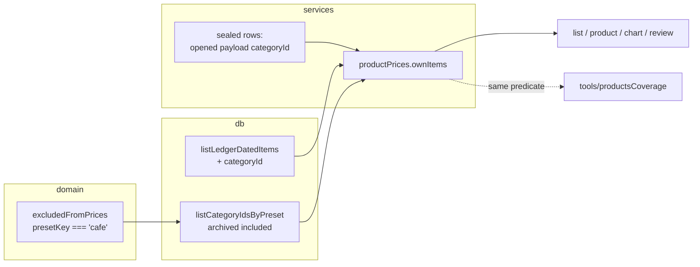

# 0050: Product prices without cafe and restaurant receipts

> **Status:** in-progress (2026-10-11)
> **Created:** 2026-10-11
> **Related ADRs:** [ADR-0051](../adrs/0051-product-prices-leave-out-cafe-receipts-by-category.md), [ADR-0039](../adrs/0039-products-from-keyword-rules-and-per-user-overrides.md), [ADR-0041](../adrs/0041-product-matches-memoized-in-process-not-persisted.md), [ADR-0020](../adrs/0020-sealed-ledgers-write-open-read-locked.md)

## TL;DR

`/prices` stops counting receipt items from cafes and restaurants. An item counts only when its
expense is not in the ledger's «Кафе и рестораны» category (`preset_key = 'cafe'`). The first thing
the owner sees: a month's «Молоко» price on `/prices` no longer jumps when a cafe receipt lands in
it, and «cappuccino» no longer waits in the review of unmatched names.

## Context & problem

`/prices` is the owner's shop inflation check (Plan 0036). Cafe receipts carry cooked food and
drinks whose names match the catalog at several times the shop price, so one cafe visit distorts
a month's unit price. They also fill the review queue with dishes nobody wants matched. The
2026-10-11 coverage report showed cafe items such as prepared salads and coffee among the unmatched
names.

## Decision

Leave out every item whose expense's category carries `preset_key = 'cafe'`, archived or not, on
every path that reads items for products (ADR-0051). The rule lives in one place in
`src/services/productPrices.ts`, applied to the plaintext rows and to the opened sealed rows
alike. The coverage tool applies the same predicate. We rejected seller-name keywords because they
guess with no correction path, groceries-only because it drops fuel and pharmacy prices, and a
per-category switch because it adds a migration and UI for a case the owner does not have.

## Architecture diagram



## Implementation phases

### Phase 1: Cafe receipts leave /prices

- **Owner skill:** dev
- **What:** `listLedgerDatedItems` also returns each item's expense `categoryId`. A new
  `listCategoryIdsByPreset(db, ledgerId, presetKey)` in `src/db/categories.ts` returns the ids of a
  ledger's categories with that preset key, archived ones included (as `listEssentialCategoryIds`
  does). The preset key that keeps items out of prices is a named constant beside the presets in
  `src/domain/categoryPresets.ts`. `ownItems` in `src/services/productPrices.ts` drops every
  plaintext item and every opened sealed item whose category is in that set; for a sealed row the
  category is the opened payload's `categoryId`, read in the same open that yields the receipt
  (extend `foldedReceiptOf` or add a sibling in `src/services/ledgerKeys.ts`, so a row is opened
  once). Since every screen goes through `resolveItems`, the product list, a product's screen and
  chart, and `unmatchedNames` all follow. No bot-layer file changes.
- **Files touched:** `src/db/receiptItems.ts`, `src/db/receiptItems.test.ts`,
  `src/db/categories.ts`, `src/db/categories.test.ts`, `src/domain/categoryPresets.ts`,
  `src/services/productPrices.ts`, `src/services/productPrices.test.ts`,
  `src/services/ledgerKeys.ts`, `src/services/productReview.test.ts`.
- **Done when:** service tests on a personal ledger with default currency RSD, the viewer's
  receipts in September 2026:
  - A receipt under «Продукты» with `MLEKO 1L`, quantity 1, 150.00 RSD, and a receipt under «Кафе и
    рестораны» with `MLEKO 1L`, quantity 1, 400.00 RSD: «Молоко»'s September line reads spent
    15000 minor and unit price 15000 minor per litre, not 55000 and 27500.
  - Moving the cafe expense to «Продукты» and reading again gives spent 55000 and unit price 27500
    minor per litre (55000 over 2 l), with no restart: nothing is cached per item.
  - A cafe receipt item `CAPPUCCINO` is not in `unmatchedNames`; the same name on a «Продукты»
    receipt is.
  - Archiving «Кафе и рестораны» keeps its expenses' items out.
  - A receipt under a user-created «Обеды» (no preset key) counts.
  - An unlocked sealed ledger with the same two receipts gives the same 15000 / 15000 figures.
  - A group ledger leaves its own cafe category's items out, and the viewer still sees only their
    own items (unchanged).

### Phase 2: The coverage report and the guide follow

- **Owner skill:** dev
- **What:** `src/tools/productsCoverage.ts` leaves the same items out of its counts, and prints one
  line per ledger with how many items and how much spend it left out as cafe. The guide's `/prices`
  section in `site/src/content/docs/guide/receipts.mdx` gains one sentence: receipts filed under
  «Кафе и рестораны» don't count toward prices, and moving a receipt to another category brings it
  back.
- **Files touched:** `src/tools/productsCoverage.ts`, `src/tools/productsCoverage.test.ts`,
  `site/src/content/docs/guide/receipts.mdx`.
- **Done when:** a coverage test with one «Продукты» item matched and one cafe item unmatched
  reports items 1, matched 1 (100.0%), and a separate line «cafe: 1 item» with its spend; the
  cafe item is not in the unmatched list. `pnpm docs:check` exits 0.

### Phase 3: Live check

- **Owner skill:** human
- **Blocks merge:** no
- **What:** After the deploy, open `/prices` and the review. Move one cafe receipt you know
  matched a product (coffee, beer, bread) to «Продукты» and back.
- **Files touched:** none.
- **Done when:** with the receipt under «Кафе и рестораны» its item is absent from that product's
  month; under «Продукты» it is present; the review lists no cafe dishes.

## Data shapes

```ts
// illustrative: src/domain/categoryPresets.ts
export const PRICES_EXCLUDED_PRESET: PresetKey = 'cafe';

// illustrative: src/db/receiptItems.ts
export interface DatedReceiptItem extends FetchedItem {
  readonly occurredOn: LocalDate;
  readonly currency: CurrencyCode;
  readonly createdBy: UserId;
  readonly categoryId: CategoryId | null; // new
}
```

No migration, no callback data, no new copy in the messages module.

## Risks & open questions

- **Sealed rows open twice** if the category is read in a second `open` call. Phase 1 reads it in
  the same open as the receipt.
- **A ledger created before categories** (`listLedgersWithoutCategories`) has no cafe category, so
  nothing is excluded there. That is correct: nothing is filed as cafe.
- **Privacy:** no amounts or names are logged; the coverage report stays a local, owner-run tool.

## What this plan does NOT do

- A per-category "not for prices" switch (ADR-0051, Alternative C). A later plan if needed.
- Seller-name detection of cafes.
- Any change to [Позиции] (receipt items by category for a period, Plan 0035), which shows
  cafe items as spending, as it should.
- Any bot-layer change: Plan 0049 is in flight on `src/bot/`.

## Implementation log

> Written by `dev`: one row per phase as its commit lands, then the close block. **The phases
> above are the contract. This section records what happened.** Observations, never conclusions:
> no pass list, no self-assessment. Deviations and unmet done-whens are **always** disclosed.
> Keep it shorter than `## Implementation phases`.

| phase | owner | state | commit |
|---|---|---|---|
| 1: Cafe receipts leave /prices | dev | done | 20c97e5 |
| 2: The coverage report and the guide follow | dev | done | committed with this row |
| 3: Live check | human | not started | |

### Notes

### Close triggers

## Followups
