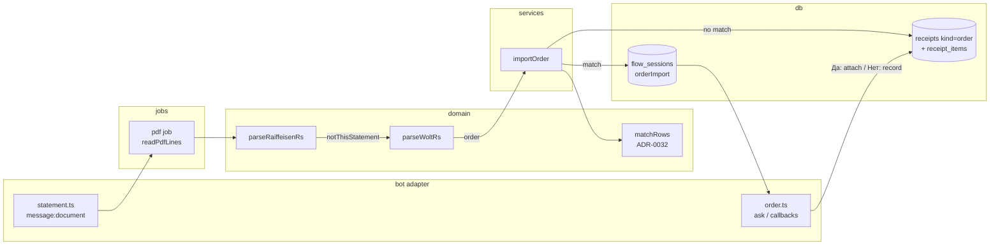

# 0051: A delivery-order PDF records one expense with its dishes

> **Status:** approved (2026-10-12)
> **Created:** 2026-10-12
> **Related ADRs:** [ADR-0052](../adrs/0052-delivery-orders-are-receipts-of-kind-order.md), [ADR-0032](../adrs/0032-statement-rows-match-recorded-expenses.md), [ADR-0033](../adrs/0033-pdf-statements-via-pdfjs-dist.md), [ADR-0042](../adrs/0042-heavy-jobs-in-a-child-process-handed-off-by-the-handler.md)

## TL;DR

The user forwards Wolt's order confirmation PDF («Potvrda porudžbine») to the bot in DM. The bot
records one expense: the restaurant as its description, the order total, the delivery time, and
the dishes as items on the card, the same way a scanned fiscal receipt looks. If an expense with
the same amount is already recorded within a day, the bot asks first. «Да» attaches the dishes to
that expense, and «Нет» records the order separately. The first thing the user sees is a card
reading «Gong Lok · 2 позиции» right after sending the file.

## Context & problem

Today a PDF that isn't a Raiffeisen statement gets the stray-message reply
(`src/bot/handlers/statement.ts`). The owner orders delivery through Wolt, which emails a
one-page order confirmation. It carries the restaurant, the delivery time, the card payment, the
dish lines with VAT and the total. The bot's PDF reader (`readPdfLines`) already reads it into
clean positioned lines. This was checked on a real order on 2026-10-12, and that file is not
committed.

The order often already exists in the ledger. The user may have typed «1144 доставка», or a bank
SMS or statement row may have recorded the card charge. Recording again doubles the month. The
paper fiscal receipt also travels in the delivery bag («Račun se nalazi u torbi za dostavu»).
Scanning its QR after importing the PDF records the order twice. This plan leaves that case to the
user (see «What this plan does NOT do»).

## Decision

A second PDF parser, `parseWoltRs`, runs on the same lines whenever `parseRaiffeisenRs` answers
`notThisStatement`. It is a pure domain function. An order is stored as a `receipts` row of kind
`order` with its dishes in `receipt_items` (ADR-0052). Before recording, the service looks for a
match with ADR-0032's rule (same amount in minor units, same currency, `occurred_on` within one
day), restricted to the user's own live expenses. With no match it records right away, as a QR scan
does. With a match it holds the parsed order in a `flow_sessions` row and asks. We rejected a
separate order table (ADR-0052), a preview before every recording (an extra tap per order, with the
user's choice going the other way), and matching on the QR side too (deferred: it changes the
fiscal flow).

## Architecture diagram



## Implementation phases

### Phase 1: A Wolt PDF records an expense with its dishes

- **Owner skill:** dev
- **What:** the migration and storage of ADR-0052, the `parseWoltRs` parser, and an
  `importOrder` service that records on no match. Every existing reader of the fiscal fields
  narrows on `kind`. Phase 1 records even when an expense matches. Phase 2 adds the question.
- **Files touched:** `src/db/migrations/0030_receipt_kinds.sql`, `src/db/receipts.ts`,
  `src/db/receipts.test.ts`, `src/db/connection.test.ts` (where migrations are tested),
  `src/domain/orders/types.ts`, `src/domain/orders/woltRs.ts`, `src/domain/orders/woltRs.test.ts`,
  `src/domain/orders/testing/buildWoltRs.ts`, `src/services/importOrder.ts`,
  `src/services/importOrder.test.ts`, `src/bot/handlers/statement.ts`, `src/bot/messages.ts`,
  `src/domain/sealing.ts`, `src/services/sealLedger.ts`, `src/services/exportLedger.ts`,
  `src/services/fetchDueReceipt.ts`, `src/services/recordReceipt.ts`, and their tests where a
  type narrows.
- **Parsing rules** (from the real layout; see «Data shapes» for the line picture):
  - Recognised by a first-page line that starts with `Potvrda porudžbine #`. Anything else gives
    `notThisOrder`, which keeps today's stray reply.
  - Read by label in the left column, value in the rightmost cell: `ID porudžbine` (the order id,
    24 hex characters), `Lokacija` (the restaurant, which becomes the description),
    `Vreme dostave` (`dd.mm.yyyy HH:MM`, local Europe/Belgrade), and the `PIB:` line (the seller's
    tax id, used for `merchant_key = wolt-rs:<PIB>`). The parser never reads `Korisnik` (the
    customer's name) or the card digits from the payment line.
  - Amounts are Serbian format `1.144,00`: `.` groups thousands and `,` marks the decimals. They
    are parsed straight to integer minor units, never through a float. Every cell is stripped of
    U+200E / U+200F before matching, because `pdftotext` shows a U+200E before each amount.
  - Item rows lie between the header row (`Artikal … Cena`) and `Ukupno u RSD (sa PDV-om)`. A line
    whose first cell sits at the table's left margin starts an item, and its last cell is the
    item's total. The indented lines that follow it (first cell to the right of the margin) are
    the dish's own line and its options («Da li želiš pribor?: Ne, hvala»), and they add nothing
    to the total. The item's quantity is the `Količina` cell of the indented line whose name equals
    the item's. Failing that, it is the item line's own `Količina` cell (a dish with no options is
    one full line). Failing that, it is `"1"`.
  - Checks, each failing to `unreadableOrder` (never a guess): the item totals sum to the `Ukupno`
    amount, the payment lines between `Način plaćanja` and the table sum to it, the currency named
    in `Ukupno u RSD` is `RSD`, and every required label is present. A delivery fee, a tip or Wolt
    credits in a layout not yet seen therefore refuse instead of mis-recording.
- **Recording** (`importOrder`, beside `recordReceipt`):
  - The order is refused in a sealed ledger, with the reply a QR scan gets there (`sealedLedger`).
  - An `order_key` already present answers «уже записано» plus that expense's card, like a
    duplicate QR scan.
  - `amount_minor` is the `Ukupno` amount in RSD. `occurred_at` is the delivery instant (Belgrade
    local converted to UTC). `occurred_on` is that instant's local date in the user's timezone.
  - The description is the `Lokacija` text. The category is the merchant's history
    (`findMerchantCategory` on `wolt-rs:<PIB>`), else the ledger's `cafe` preset category when it
    is active, else `suggestCategory`'s fallback.
  - The expense `source_key` is `order:<order_key>`. One transaction writes the expense, the
    `receipts` row (`kind = 'order'`, `fetch_state = 'fetched'`, `seller_name` = the `Lokacija`
    text, `issued_at` = the delivery instant) and its `receipt_items`. The card is the receipt
    card, items folded in or behind [Позиции] as today.
  - A delivery time later than the message's date is refused like a future receipt.
  - A PDF that is an order but fails a check gets a new `messages.orderUnreadable` («Не получилось
    разобрать заказ из PDF. Запишите его текстом, например: 1144 доставка»).
  - The one info log line per PDF gains the outcomes `order`, `orderDuplicate` and
    `orderUnreadable`. It carries sizes, line counts and the outcome, never the restaurant, an
    amount, the customer's name or the card digits.
- **Done when:**
  - The migration test opens a database at the previous migration with one RS and one ME fiscal
    receipt plus their items, migrates it, and finds both rows with the same ids, `kind = 'fiscal'`
    and their item counts intact. Inserting a `kind = 'order'` row with a non-null `fiscal_id`, or a
    `kind = 'fiscal'` row with a null `verify_url`, throws on the CHECK. Inserting two order rows
    with the same `order_key` throws on the unique index.
  - `parseWoltRs` on the synthetic fixture (see «Data shapes») returns the order id
    `0123456789abcdef01234567`, the restaurant «Primer Kuhinja», delivery `2026-10-12 13:26`, total
    114400 RSD minor units, and exactly two items: «Nudle sa povrćem» quantity `"1"` 97500 and
    «Prolećne rolnice» quantity `"1"` 16900 (97500 + 16900 = 114400). The option line is not an
    item. The result contains neither «Test Korisnik» nor `0000`. The test asserts this by
    serialising the result and searching it.
  - The same fixture with its `Ukupno` changed to `1.244,00` gives `unreadableOrder`. With an
    extra payment line `Wolt krediti 100,00` it gives `unreadableOrder`. A Raiffeisen statement
    fixture gives `notThisOrder`.
  - `importOrder` for a user in Europe/Belgrade records 114400 RSD with `occurred_at`
    `2026-10-12T11:26:00Z` (CEST is UTC+2 until 2026-10-25) and `occurred_on` `2026-10-12`.
    The card shows «Primer Kuhinja · 2 позиции».
  - A fixture delivered `12.10.2026 01:30` gives `occurred_at` `2026-10-11T23:30:00Z`. For a user
    in America/New_York (EDT, UTC−4) that is `occurred_on` `2026-10-11`, and for a user in
    Europe/Belgrade it is `2026-10-12`.
  - Importing the same fixture twice leaves one expense and one order receipt, and the second
    import returns the duplicate.
  - The category goes to the ledger's `cafe` preset category with no history. After the user moves
    that expense to another category, a second order from the same PIB goes to that category.
  - Sealing a ledger that holds an order expense, then opening it, returns the receipt with
    `verifyUrl: null` and both items. A payload sealed with a string `verifyUrl` still opens. The
    export of that ledger lists the order expense with `receiptUrl: null` and its items.

### Phase 2: A matching expense is asked about

- **Owner skill:** dev
- **What:** before recording, `importOrder` looks for a match among the user's own live expenses in
  the ledger (`matchRows` from `src/domain/statements/match.ts`, one row, ADR-0032's rule). On a
  match it stores the parsed order and the candidate expense id in a `flow_sessions` row of kind
  `orderImport` (10-minute TTL, like the statement flow) and asks.
- **Files touched:** `src/services/importOrder.ts`, `src/services/importOrder.test.ts`,
  `src/services/flowSessions.ts`, `src/bot/flows.ts`, `src/bot/handlers/order.ts`,
  `src/bot/handlers/order.test.ts` (or the existing handler test harness),
  `src/bot/handlers/statement.ts`, `src/bot/callbackData.ts`, `src/bot/messages.ts`,
  `src/bot/bot.ts`.
- **The question:** «Похоже, этот заказ уже записан:» plus the candidate's line (date, amount,
  description, the same line the day list shows), then «Это он?». The buttons are [Да, это он],
  [Нет, записать отдельно] and [Отмена]. The callback data is `ord:same`, `ord:new` and `ord:x`.
- **On [Да, это он]**, re-checked inside one transaction, since the candidate may have changed in
  the ten minutes:
  - If the candidate still is live and has no `receipts` row, the order's receipt row (with its
    `order_key`) and items attach to it. Its amount, description, category and tags are not
    touched. The message is edited into the candidate's card, now showing «Primer Kuhinja · 2
    позиции».
  - If the candidate already has a receipt (fiscal or order), nothing is written. The message
    becomes «Позиции у этой записи уже есть.» plus its card.
  - If the candidate is deleted, the order records as new, with a line saying so.
- **On [Нет, записать отдельно]**, the order records as in Phase 1.
- **On [Отмена]**, nothing is recorded. An expired flow answers `messages.flowExpired`. A second
  tap after either button finds no flow and answers `flowExpired`, so a double tap writes once.
- A re-sent PDF whose `order_key` is already present skips the question and answers «уже
  записано», even when the order was attached rather than created.
- **Done when:**
  - With a hand-typed expense of 114400 RSD on `2026-10-11`, importing the fixture (delivered
    2026-10-12, user in Belgrade) asks instead of recording. [Да] leaves exactly one expense, now
    with a `kind = 'order'` receipt and two items, and its description and category unchanged.
  - With the expense on `2026-10-10` (two days before) there is no question, and a second expense
    is recorded. With it at 114300 there is also no question.
  - With the candidate holding a fiscal receipt, [Да] writes nothing and its three fiscal items
    stay three.
  - [Нет] leaves two expenses. [Отмена] leaves one. Two [Да] taps in a row write one receipt row.
  - Another member's 114400 RSD expense in a shared ledger is not a candidate.
  - After [Да], re-sending the fixture answers «уже записано» with no question.

### Phase 3: Order items stay out of /prices; the guide covers the PDF

- **Owner skill:** dev
- **What:** order items are left out on every path ADR-0051 already filters (the product list, a
  product's screen and chart, the review of unmatched names, and `src/tools/productsCoverage.ts`),
  by `receipts.kind = 'order'`, whatever the category. The docs site's page on importing PDFs, or
  the receipts page if no PDF page exists, gains a section on the Wolt order PDF. That covers how
  to forward it, the question on a match, and that the bag's paper receipt shouldn't also be
  scanned. No docs-chat scenario: the scenario harness sends text only, and teaching it documents
  is not this plan's work.
- **Files touched:** `src/services/productPrices.ts`, `src/services/productPrices.test.ts`,
  `src/db/receiptItems.ts`, `src/tools/productsCoverage.ts`,
  `site/src/content/docs/guide/receipts.mdx`.
- **Done when:**
  - An order filed under a non-cafe category, with an item named «Hleb», adds nothing to the
    «Хлеб» product's month on `/prices`, and its items are not in the unmatched-names review.
  - `pnpm docs:check` exits 0, and the site builds.

### Phase 4: A real order end to end

- **Owner skill:** human
- **What:** after the deploy, forward a real Wolt order PDF to the bot twice: once with nothing
  recorded (it records, and the card shows the dishes), and once after typing the total by hand the
  same day (it asks, and [Да] attaches the dishes). Then re-send the first file (it says «уже
  записано»).
- **Done when:** all three behave as described, and the server log for those PDFs carries no
  restaurant name, amount, customer name or card digits.

## Data shapes

The real layout as `readPdfLines` returns it (x in points; values replaced with the synthetic
fixture's):

```
52:"Potvrda porudžbine #SRB/26/10000001/7/180"
52:"Korisnik"            | 481:"Test Korisnik"
52:"ID porudžbine"       | 405:"0123456789abcdef01234567"
52:"Lokacija"            | 509:"Primer Kuhinja"
52:"Vrsta porudžbine"    | 517:"Dostava"
52:"Vreme dostave"       | 467:"12.10.2026 13:26"
52:"Način plaćanja"
52:"Visa: ****0000"      | 514:"1.144,00"
52:"Artikal" | 269:"PDV %" | 328:"Količina" | 400:"Bruto cena artikla" | 532:"Cena"
52:"Nudle sa povrćem"                                                | 524:"975,00"
70:"Nudle sa povrćem"                | 283:"20%" | 364:"1" | 457:"975,00" | 524:"975,00"
70:"Da li želiš pribor?: Ne, hvala"  | 283:"20%" | 364:"1" | 470:"0,00"   | 538:"0,00"
52:"Prolećne rolnice"                | 283:"20%" | 364:"1" | 457:"169,00" | 524:"169,00"
52:"Ukupno u RSD (sa PDV-om)"        | 514:"1.144,00"
52:"Prodavac: PRIMER KUHINJA PR"
52:"PIB: 100000001"
```

`buildWoltRs` builds these lines with every value and x a parameter, so a test changes one field.
It contains no real name, order id, PIB or card digits. A file-level test drives the real
`readPdfLines` through `src/domain/statements/testing/buildPdf.ts`, as the statement tests do.

```ts
// illustrative
interface DeliveryOrder {
  readonly source: 'wolt-rs';
  readonly orderId: string;           // 24 hex
  readonly restaurant: string;        // «Lokacija»
  readonly sellerTaxId: string;       // PIB
  readonly deliveredAt: LocalDateTime; // Europe/Belgrade wall clock
  readonly totalMinor: number;        // RSD minor units
  readonly currency: 'RSD';
  readonly items: readonly FetchedItem[]; // name, quantity (decimal string), totalMinor
}
type ParseOrderResult =
  | { kind: 'order'; order: DeliveryOrder }
  | { kind: 'unreadableOrder' }  // recognised, but a check failed
  | { kind: 'notThisOrder' };
```

`receipts` after `0030`: `kind TEXT NOT NULL DEFAULT 'fiscal' CHECK (kind IN ('fiscal','order'))`,
`order_key TEXT` with `CREATE UNIQUE INDEX receipts_order_key ON receipts(order_key) WHERE
order_key IS NOT NULL`, `country`, `fiscal_id` and `verify_url` nullable, plus the shape CHECK from
ADR-0052. The `orderImport` flow payload is `{ order: DeliveryOrder, candidateExpenseId }`. The
customer's name and card are not in it, because the parser never produced them.

## Risks & open questions

- **One sample.** The parser is built from one order with no delivery fee, no tip, no discount
  and a single card payment. Every unknown fails closed to `orderUnreadable`. The first refused
  real order is the sample for a follow-up.
- **Quantity above 1 is a guess.** The sample has quantity 1 everywhere. The rule reads the
  dish's own indented line, and the total is the item line's own amount either way, so money stays
  right even if a quantity reads wrong.
- **Rebuilding `receipts` on production.** The migration test pins row and id survival. The
  nightly backup is taken before any deploy anyway (ADR-0044).
- **False matches** (ADR-0032's own negative): two different 1144 RSD expenses a day apart. Here
  the user sees the candidate and answers, so a false match costs one tap, not a lost expense.
- **Privacy.** The PDF carries the customer's name and the card's last digits. The parser drops
  them before anything is stored, logged or put in a flow payload, and Phase 1's test asserts it.

## What this plan does NOT do

- **No matching on the QR side.** Scanning the bag's fiscal receipt after importing the PDF
  records the order twice, and the user deletes one. That is a future plan if it happens in
  practice.
- **No other apps or layouts.** No Glovo, no English Wolt PDF, no pickup orders
  («Preuzimanje»), no orders with a delivery fee, tip or credits until a sample exists.
- **No PDFs in groups.** The PDF handler stays DM-only, as for statements.
- **No change to an attached expense's amount, description or category.** The dishes are added
  and nothing else.

## Implementation log

> Written by `dev`: one row per phase as its commit lands, then the close block. **The phases
> above are the contract. This section records what happened.** Observations, never conclusions:
> no pass list, no self-assessment. Deviations and unmet done-whens are **always** disclosed.
> Keep it shorter than `## Implementation phases`.

| phase | owner | state | commit |
|---|---|---|---|
| 1: A Wolt PDF records an expense with its dishes | dev | not started | |
| 2: A matching expense is asked about | dev | not started | |
| 3: Order items stay out of /prices; the guide covers the PDF | dev | not started | |
| 4: A real order end to end | human | not started | |

### Notes

### Close triggers

- **What shipped:**
- **User-visible surface changed:**
- **Gate at the tip:**
- **Outstanding `human` phases:**

## Followups
