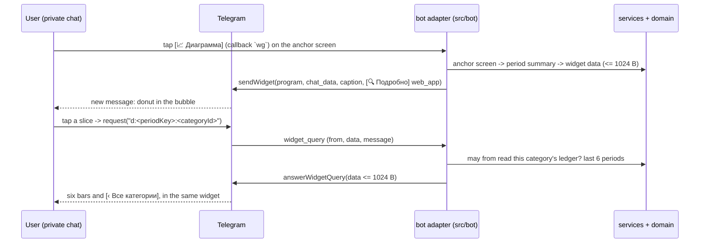

# 0052: Charts as in-chat widgets, with tap-to-drill-down answered live by the bot

> **Status:** approved (2026-11-12)
> **Created:** 2026-11-12
> **Related ADRs:** [ADR-0053](../adrs/0053-in-chat-widgets-fixed-programs-chat-data-and-widget-queries.md) (this plan's decision), [ADR-0025](../adrs/0025-static-mini-app-fragment-in-senddata-out.md) (the Mini App, kept), [ADR-0045](../adrs/0045-chart-payload-v2-deflated-sections.md) (the Mini App payload, unchanged), [ADR-0050](../adrs/0050-a-second-navigation-level-menu-hub-edited-in-place.md) (the screens a widget sits under, unchanged)

## TL;DR

The bot draws its charts inside the chat as Bot API 10.4 widgets. In a private chat, a tap on
«📈 Диаграмма» under `/week` or `/month` sends a new message below the screen. That message is a
donut of spend by category, with [🔍 Подробно] opening the full Mini App chart. Tapping a slice
asks the bot, which answers with that category's last six periods, read live from the database.
The budget, `/today`, `/prices` and tag reports follow. The text screens and their in-place
navigation don't change.

Two things stay as they are:

- The Mini App, which keeps the full charts.
- The 📷 Скан receipt scan, which stays in the Mini App because widgets have no camera.

The feature ships behind `WIDGETS=on`.

## Context & problem

Chat can't draw. Every chart today means a tap on «📈 Диаграмма», a Mini App page load and a
snapshot of the numbers taken when the button was sent (ADR-0025). Live reads were rejected
because they need an HTTPS API this VPS can't host. Bot API 10.4 widgets remove both limits.
They draw in the bubble, and a tap reaches the bot over long polling as a `widget_query`. The
limits that shape this plan are in ADR-0053's Context: 4096 bytes of compressed code, 1024 bytes
of `chatData`, 64-byte requests and 1024-byte answers.

## Decision

As ADR-0053 records:

- Each chart kind is one fixed program under `widgets/`, size-gated by a test.
- The numbers travel as versioned positional JSON in `chatData`.
- Drill-down is a `request()` the bot answers after the same ledger check callbacks use.
- The widget is a separate message, sent on a tap of the screen's chart button, never on every
  render (the placement `ux-telegram` designed).
- The four 10.4 methods go through one wrapper. It calls grammY's raw API until a grammY release
  ships 10.4 types. That release is exempt from the 7-day cooldown.

We rejected these alternatives (ADR-0053):

- **Numbers baked into each widget's HTML** (A): a shown chart could never be refreshed.
- **Numbers fetched when the widget is shown** (B): a query per view, and blank offline.
- **Keeping the cooldown for grammY** (C): the owner's call to exempt it.
- **Retiring the Mini App** (D): the scan needs a camera.
- **Placing the widget differently** (E): turning the screen itself into a widget breaks
  in-place paging and the ☰ Меню hub, and sending a widget on every render floods the chat.

## Architecture diagram



## UX

This section is the `ux-telegram` design (2026-11-12). Its copy keys are binding for `dev`. The
wording can be tuned in the messages module.

**The chart button.** With `WIDGETS=on`, «📈 Диаграмма» on a screen in a private chat is a
callback button with data `wg` (2 bytes). The screen's kind, period, ledger and product come from
the anchor's stored screen (`requireScreen`, as [По категориям] does).

**What a tap does:**
- **On the anchor:** the callback is answered silently, and a new widget message is sent below
  the screen. It carries a caption and the inline keyboard [🔍 Подробно]. That button is a
  `web_app` button with the Mini App URL the screen builds today. /today has no Mini App chart,
  so its widget gets no button.
- **Again on the same anchor and period:** a `chartAlreadySent` toast, and nothing is sent.
- **After paging the screen to another period:** a new widget. The old one stays as a snapshot,
  and its caption names its period and time.
- **On an older copy of the screen:** the `staleScreen` toast (an existing key), and nothing is
  sent.

**When there's no widget button.**
- **With `WIDGETS` absent:** the button stays the `web_app` button it is today.
- **Group chats:** they have no chart button today, because `web_app` buttons are private-only
  and group summaries are a separate composer (ADR-0014). They still get none.
- **A locked ledger:** it shows its locked message instead of the screen, as today.
- **No data** (an empty period, a budget with no limit, an empty `/today` week): no button.

**The keyboard fallback.** If Phase 1 finds that a widget message can't carry an inline
keyboard, the screen's last row becomes `[📈 В чате] [🔍 Подробно]` and the widget has no
keyboard.

**Inside the widget:**
- **The donut:** the period title, the total in the donut's centre, and up to 8 legend rows,
  the last of which may be «Остальное». A currency with no rate gets one more line,
  `widgetUnconverted`.
- **A tap on a slice or legend row** (not «Остальное»): the row shows «…» and sends the request.
  The answer switches the widget to six bars titled `widgetDrillTitle`, with [‹ Все категории].
  That button returns to the donut locally, with no request.
- **When the request fails:** the bot's error text shows in place of the bars, and the row stays
  tappable.
- **Size:** the donut and bars states share one height, about 380 px. The design targets a
  320 px width. A long label is cut with an ellipsis, and the amount stays right-aligned.
- **Colours:** theme params only, muted with the hint colour, never with `opacity`.

| screen | button | widget | taps inside |
|---|---|---|---|
| /week, /month | existing | donut, drill-down over 6 weeks or 6 months | yes |
| Budget | existing | burn-down: remaining amount against the ideal line, a status line on top | none |
| /today | new, last row, only when the 7 days have spend | 7 day bars, today highlighted | none |
| /prices product | existing | price per unit by month | none |
| Tag report | existing | donut without row chevrons | none |

**Copy keys** (`src/bot/messages.ts`):

| key | text |
|---|---|
| `chartDetailButton` | `🔍 Подробно` |
| `chartInChatButton` | `📈 В чате` (keyboard fallback only) |
| `chartAlreadySent` | `Диаграмма уже ниже в чате.` |
| `widgetCaption(period, at)` | `Ноябрь 2026 · на 12 ноября, 14:05` |
| `widgetCaptionApprox(rateDate)` | appended: ` · ≈ по курсу НБС на 11 ноября` |
| `widgetDrillTitle(category, n, kind)` | `Еда · последние 6 месяцев`, with the plural helper |
| `widgetBack` | `‹ Все категории` |
| `widgetUnavailable` | `Эта категория больше недоступна.` |
| `widgetLocked` | `Учёт закрыт. Откройте его в боте, чтобы смотреть детали.` |
| `widgetRetry` | `Не получилось загрузить. Нажмите ещё раз.` |
| `widgetUnconverted(amounts)` | `+ 120 EUR без курса` |
| fold label | the existing `chartFold`, reused |

## Implementation phases

`dev` implements all phases in one session. Each phase is one commit. `WIDGETS` stays off in
production until Phase 6.

### Phase 1: «📈 Диаграмма» under /week and /month sends a donut widget
- **Owner skill:** dev
- **What:** Build the pipeline end to end:
  - the `widgets/` project and its build;
  - the size gate;
  - the `widgetApi.ts` wrapper;
  - the `WIDGETS` config key;
  - the domain encoder for `chatData`;
  - the donut program, without taps yet;
  - the `wg` callback, with its stale and already-sent handling;
  - the caption and the [🔍 Подробно] keyboard.

  `dev` records in the log whether Telegram accepted `reply_markup` on `sendWidget`. If it didn't,
  `dev` builds the keyboard fallback from the UX section instead.
- **Files touched:**
  - `widgets/tsconfig.json`, `widgets/src/donut.ts`, `widgets/src/runtime.ts` (shared helpers, a
    typed `TelegramWidget` declaration);
  - `scripts/build-widgets.ts`, which compiles each program and writes
    `src/bot/widgets/programs.generated.ts`, one exported HTML string per program, committed;
  - `src/bot/widgets/programs.test.ts`, `src/bot/widgetApi.ts`;
  - `src/domain/widgetData.ts`, `src/domain/widgetData.test.ts`;
  - `src/config.ts`, `.env.example`, `package.json` (`build:widgets`, with `typecheck` extended to
    `widgets/`), and `pnpm-workspace.yaml` only if ADR-0053's grammY exemption is taken (Risk 3);
  - `src/bot/callbackData.ts` (`wg`), `src/bot/handlers/widgetChart.ts` (new: the `wg` callback),
    `src/bot/handlers/summary.ts`;
  - `src/services/flowSessions.ts` (the already-sent mark on the anchor screen: its kind and
    period key);
  - `src/bot/messages.ts`, `src/bot/bot.ts`, `src/bot/bot.test.ts`.
- **Done when:**
  - `programs.test.ts` deflates every exported program with zlib level 9 and fails above
    4096 bytes. It also fails when `pnpm build:widgets` would write a different
    `programs.generated.ts` than the committed one.
  - `widgetData.test.ts` shows that a month with 20 categories encodes to at most 1024 UTF-8
    bytes. It folds the smallest into one line named `chartFold`, and the folded line's minor
    units equal the sum of the lines it replaced.
  - Separately, `widgetData.test.ts` shows that a line whose label is 40 Cyrillic characters is
    measured in bytes, not characters: 80 bytes of label.
  - With `WIDGETS=on` and the summary's Mini App URL configured, `bot.test.ts` covers:
    - A user in `Europe/Belgrade` opens `/month` in a private chat at 2026-11-12T13:05Z and taps
      `wg` on it. `sendWidget` is called once, with:
      - `chat_data` equal to the encoder's output;
      - caption `Ноябрь 2026 · на 12 ноября, 14:05` (CET is UTC+1 in November);
      - one `web_app` button, `🔍 Подробно`, whose URL equals the one the screen built.
    - A second `wg` tap on the same anchor answers `chartAlreadySent` and calls nothing.
    - Paging to October and tapping `wg` sends a second widget, captioned `Октябрь 2026 · …`.
    - A `wg` tap on a message that isn't the anchor answers `staleScreen` and calls nothing.
  - **The cases where the button isn't `wg`:**
    - With `WIDGETS` absent, `/month` in a private chat keeps the `web_app` «📈 Диаграмма» exactly
      as before, with no `wg` button and unchanged text.
    - In a group chat, `/month` (`src/bot/group/summary.ts`) is unchanged: no chart button of
      either kind.
    - On a locked ledger, `/month` answers the existing locked message and calls no `sendWidget`.

### Phase 2: Tap a slice for its last six periods
- **Owner skill:** dev
- **What:** The donut sends `request("d:<periodKey>:<categoryId>")` on a tap of a slice or
  legend row other than the fold line. A `widget_query` handler parses it as untrusted input,
  checks the asker's access to the category's ledger, and answers with that category's last six
  periods, ending at the requested period. The donut shows «…» on the tapped row while it waits,
  then the bars titled `widgetDrillTitle` with [‹ Все категории]. Any failure shows the error's
  text in place of the bars and leaves the row tappable. A failure is either an error answer
  (`widgetUnavailable`, `widgetLocked`) or a request error (`TIMEOUT`, `RATE_LIMITED`, `BUSY`,
  `FAILED`). A request error shows `widgetRetry`, which the bot sends in `chatData` for that
  purpose.
- **Files touched:** `widgets/src/donut.ts`, `src/bot/widgets/programs.generated.ts`,
  `src/bot/handlers/widgetQuery.ts` (new), `src/bot/handlers/widgetQuery.test.ts`,
  `src/bot/widgetApi.ts`, `src/bot/bot.ts`, `src/domain/widgetData.ts` (+ test, the answer
  encoder), `src/services/periodTrend.ts` (or `periodCategory.ts`, whichever already returns a
  category's periods; no new SQL if one does), `src/bot/messages.ts`.
- **Done when:**
  - `widgetQuery.test.ts` passes for each of these through `bot.handleUpdate`:
    - A query from the ledger's owner for `d:2026-11:<their category>` is answered once, with six
      points, June to November 2026. Each point's minor units equal that category's total for
      that month in the user's timezone.
    - A query for `d:2026-11-09:<category>` (a week) is answered with six weekly points, ending
      with the week of 9 November.
    - A query naming a category in a ledger the asker can't read is answered with
      `widgetUnavailable` and reads no amounts.
    - Malformed data (`d:`, `d:x:y`, 65 bytes) is answered with `widgetUnavailable` and no throw.
    - A locked ledger answers `widgetLocked`.
  - The answer is at most 1024 UTF-8 bytes for six periods with the longest category name the
    categories module allows.
  - The same query delivered twice is answered twice with identical data and writes nothing to
    the database.
  - A test drives the donut's tap handler with a stub `TelegramWidget`. A tap on the fold line
    makes zero `request` calls, and a tap on another row makes exactly one, with data
    `d:<that row's token>`.

### Phase 3: Budget burn-down and /today widgets
- **Owner skill:** dev
- **What:** Two more programs, each sent by the same `wg` flow as Phase 1:
  - `burndown`: the budget period's remaining amount against the ideal line, from the same
    service the Mini App burn-down uses. It's sent from the budget screen's existing button.
  - `days`: `/today`'s last seven day totals, with today highlighted. It's sent from a new
    «📈 Диаграмма» on `/today`'s last row, shown only when those seven days have spend. This
    widget has no [🔍 Подробно].
- **Files touched:** `widgets/src/burndown.ts`, `widgets/src/days.ts`,
  `src/bot/widgets/programs.generated.ts`, `src/domain/widgetData.ts` (+ test),
  `src/bot/handlers/budget.ts`, `src/bot/handlers/today.ts`, `src/bot/handlers/widgetChart.ts`,
  `src/services/todaySummary.ts` (a `recentDayTotals` read if none exists; seven days ending today
  in the user's timezone), `src/bot/messages.ts`, `src/bot/bot.test.ts`.
- **Done when:**
  - Both new programs pass the 4096-byte gate.
  - The `recentDayTotals` test puts a user in `Europe/Belgrade` with an expense at
    2026-11-11T23:30Z, which is 00:30 on the 12th local time. With the clock at
    2026-11-12T10:00Z, that expense counts in the 12th's total, the last of the seven days, not
    the 11th's.
  - In `bot.test.ts`, a budget with no limit shows no `wg` button, and `/today` with no spend
    over the seven days shows no chart button. `/today` with spend shows one, and its widget
    message has no inline keyboard.

### Phase 4: /prices and tag widgets
- **Owner skill:** dev
- **What:** A product's price per unit by month reuses the `days` bars program if it fits, or
  else gets a `spark` program. A tag's pie reuses `donut` with drill-down off in its `chatData`:
  no chevrons, and taps do nothing. Both are sent from the screens' existing buttons by the `wg`
  flow.
- **Files touched:** `widgets/src/spark.ts` (only if needed), `src/domain/widgetData.ts`
  (+ test), `src/bot/handlers/prices.ts`, `src/bot/handlers/tags.ts`,
  `src/bot/handlers/widgetChart.ts`, `src/bot/bot.test.ts`.
- **Done when:**
  - A product with prices in two currencies sends only the ledger-currency months, matching what
    its Mini App chart shows today.
  - A test drives the donut's tap handler with a stub `TelegramWidget` and tag `chatData`, and
    asserts zero `request` calls on any row.

### Phase 5: Docs
- **Owner skill:** dev
- **What:** Document the feature where users and future sessions look:
  - `README.md` and `.env.example` gain `WIDGETS`;
  - `CLAUDE.md` "Where things live" gains `widgets/`;
  - the site guide (`site/`) describes the in-chat chart, the slice tap and [🔍 Подробно], and
    that the scan stays in the Mini App;
  - the help screen's charts topic gains one line on tapping a slice.
- **Files touched:** `README.md`, `.env.example`, `CLAUDE.md`, `site/src/content/docs/…` (the
  charts page), `src/bot/messages.ts`.
- **Done when:** `pnpm docs:check` and `node scripts/check-doc-links.mjs` exit 0, and the guide's
  charts page names both the widget and the Mini App chart.

### Phase 6: Live check on real clients, then switch it on
- **Owner skill:** human
- **What:** Run the checks below with `WIDGETS=on` on a test deploy, then set it in production.
- **Done when:** All of these hold:
  - On an Android phone, an iPhone (or iPad) and Telegram Desktop, «📈 Диаграмма» under
    `/month` sends the donut, with [🔍 Подробно] (or the fallback row) opening the Mini App chart.
  - The time overlay doesn't cover the legend's last row.
  - A slice tap shows six bars within 2 seconds, and [‹ Все категории] returns to the donut.
  - The budget, `/today`, `/prices` and tag widgets each render.
  - `widget_query` updates arrive without any `allowed_updates` change. If they don't, file a
    `dev` fix that passes `allowed_updates` explicitly.

## Data shapes

```ts
// illustrative: src/domain/widgetData.ts. Positional to save bytes. JSON.stringify of this
// must be <= 1024 UTF-8 bytes. v bumps on any shape change; a program shows its "update the bot"
// glyph on a v it doesn't know.
type DonutData = [
  v: 1,
  title: string,          // «Ноябрь 2026», formatted by messages
  total: string,          // «45 230 RSD» or «≈ 45 230 RSD»
  drill: 0 | 1,
  lines: Array<[label: string, minor: number, amount: string, token: string]>, // token: `${periodKey}:${categoryId}`, '' on the fold line
  extra: string,          // widgetUnconverted, or ''
  retry: string,          // widgetRetry, shown on a request error
];
type DrillAnswer =
  | [v: 1, title: string, points: Array<[label: string, minor: number, amount: string]>]
  | [v: 1, error: string]; // widgetUnavailable or widgetLocked, already worded
// `wg` callback: 2 bytes. Request data `d:${token}`: `d:2026-11-09:1234567890` is 23 bytes, under 64.
```

`minor` is used only for geometry (angles, heights), as in ADR-0025. No program adds, divides
for display or formats money.

## Risks & open questions

1. **A keyboard under a widget is unverified.** The docs say only indirectly that `sendWidget`
   accepts `reply_markup`. Phase 1 finds out, and the UX section's fallback row covers the no
   case.
2. **The 4096-byte gate may not fit the donut with drill-down.** If it doesn't, drill-down moves
   to its own `bars` program, sent by a button under the donut, and Phase 2's done-whens apply to
   that program instead. `dev` records the measured sizes in the log.
3. **Untyped API.** A parameter misspelled in `widgetApi.ts` fails only at runtime. The
   `bot.test.ts` fakes assert the exact method names and parameter keys from the Bot API page,
   and Phase 6 is the real check.

   If a grammY release with 10.4 types is out when `dev` starts, `dev` takes ADR-0053's exemption
   in its own commit before Phase 1:
   - pin the exact version;
   - add one `minimumReleaseAgeExclude` entry in `pnpm-workspace.yaml`;
   - commit the lockfile;
   - write `widgetApi.ts` on the typed methods.

   The log records the version and its publish date. If no such release is out, the wrapper ships
   untyped, and the upgrade is a later chore under the same exemption. Either way, removing the
   entry once the version is 7 days old is a followup in this plan.
4. **Privacy.** `chatData` holds aggregates and category names, the same as the summary text.
   A locked ledger never gets a widget. Requests carry ids only, never amounts. The log lines
   for `widget_query` stay at debug level for any amount.
5. **Send limits.** Each widget costs one message, but only on a deliberate tap, and a repeat tap
   on the same anchor and period sends nothing. A user can still send many by paging and tapping;
   Phase 6 watches for 429s.

## What this plan does NOT do

- **Scanning in a widget.** Widgets have no camera. The 📷 Скан Mini App stays (Plan 0032).
- **Live refresh of a shown widget** with `editMessageWidgetData`, for example a budget gauge that
  moves after each expense. That needs the bot to store widget message ids. It's a future plan,
  which ADR-0053 leaves possible.
- **A widget on the monthly summary push** (Plan 0026). The push stays one message, with its
  chart button.
- **Taps inside the budget, `/today`, `/prices` and tag widgets.**
- **Group ledgers.** Widgets are private-chat only in production.
- **Retiring or changing the Mini App charts** or payload v2.
- **Waiting for a grammY release.** If none with 10.4 types is out when `dev` starts, the
  upgrade is a later chore under ADR-0053's exemption (Risk 3).

## Implementation log

> Written by `dev`: one row per phase as its commit lands, then the close block. **The phases
> above are the contract. This section records what happened.** Observations, never conclusions:
> no pass list, no self-assessment. Deviations and unmet done-whens are **always** disclosed.
> Keep it shorter than `## Implementation phases`.

| phase | owner | state | commit |
|---|---|---|---|
| 1: «📈 Диаграмма» under /week and /month sends a donut widget | dev | not started | |
| 2: Tap a slice for its last six periods | dev | not started | |
| 3: Budget burn-down and /today widgets | dev | not started | |
| 4: /prices and tag widgets | dev | not started | |
| 5: Docs | dev | not started | |
| 6: Live check, then switch it on | human | not started | |

### Notes

### Close triggers

- **What shipped:**
- **User-visible surface changed:**
- **Gate at the tip:**
- **Outstanding `human` phases:**

## Followups

- Remove the `grammy` entry from `minimumReleaseAgeExclude` in `pnpm-workspace.yaml` once the
  exempted version is 7 days old (ADR-0053). This applies only if the exemption was taken.
